# 🏰 数学王国 MathLand

八大主题岛，玩一玩就会了 · 适合 1-6 年级

一个专门做给孩子的数学互动乐园：把小学数学的四大领域（数与代数、图形与几何、统计与概率、综合与实践）拆成八座小岛，每座岛 8-10 个递进关卡，三星闯关、彩带烟花、学习报告，全部数据只存在本机，打开网页就能玩。

**在线体验**：https://wyy520-create.github.io/MathLand/

## 🏝️ 八大主题岛

| 岛 | 适合年级 | 玩什么 |
| --- | --- | --- |
| 🧊 积木岛 | 2-5 年级 | 3D 观察物体：数方块、认三视图、按视图搭积木、数暴露面 |
| ⚡ 口算岛 | 1-6 年级 | 加减乘除闪电战，一关 10 题，越算越快 |
| 🕐 时间岛 | 1-3 年级 | 拖得动的指针：认识整点、半点、几分，时针分针真实联动 |
| 🛒 购物岛 | 1-3 年级 | 小商店学人民币：算价钱、找零钱、凑钱付款 |
| 🍕 分数岛 | 3-5 年级 | 切披萨学分数：看图选分数、动手涂色、比大小 |
| 🧭 方向岛 | 1-4 年级 | 东南西北走迷宫：每关都是程序验证有解的地图 |
| 🐔 趣题岛 | 4-6 年级 | 鸡兔同笼：1500 岁名题的抬腿法分步动画 |
| 📊 统计岛 | 2-5 年级 | 条形统计图：会看图、会画图、认识平均数 |

## ✨ 玩法与功能

- **三星闯关**：一次答对得 3 星，错一次或用提示得 2 星，通关解锁下一关
- **温柔的提示**：每关的「💡 提示」不是直接报答案，而是讲思路（比如数方块教"分层数"）
- **积木岛小帮手**：剥洋葱滑块可以一层层剥开积木检查；「上色」会把暴露面染色；相机可以飞到前/上/左面对齐课本里的三视图
- **鸡兔同笼演示**：全体抬 1 条腿 → 再抬 1 条腿 → 鸡坐地上了 → 剩下的全是兔子的腿，四步动画看懂抬腿法
- **学习报告**：八岛正确率一目了然，还会给家长一句具体的陪伴建议
- **本地存储**：进度与星星只存在浏览器本机（localStorage），不上传任何数据

## 📸 界面一览

| | |
| --- | --- |
| 主菜单地图 | 选关页（带星星） |
| 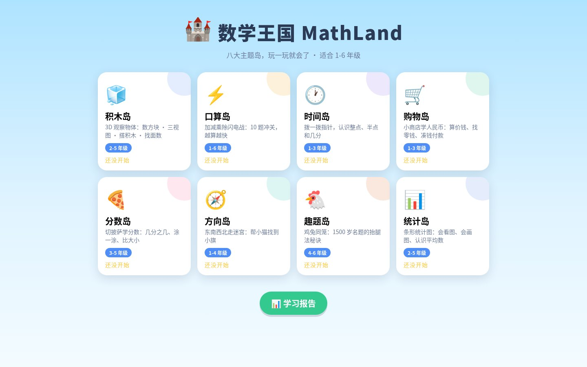 | 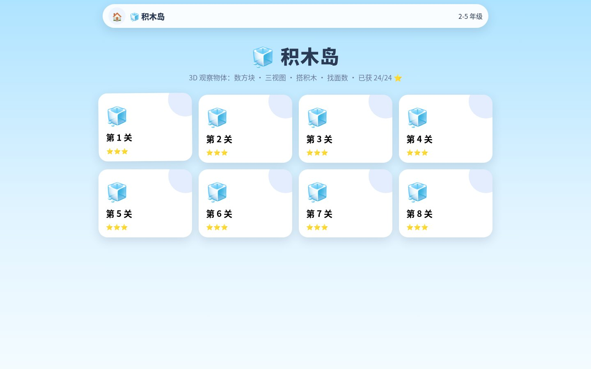 |
| 积木岛 · 数方块 | 积木岛 · 剥洋葱辅助 |
| 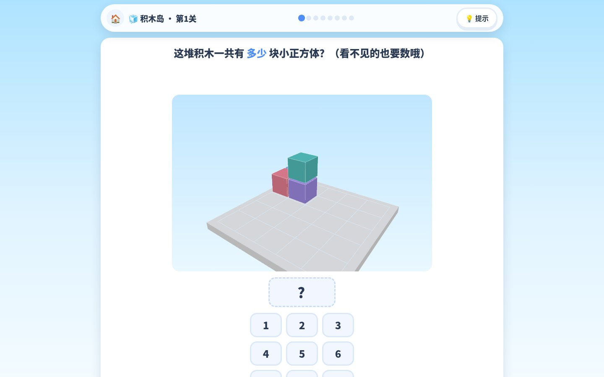 | 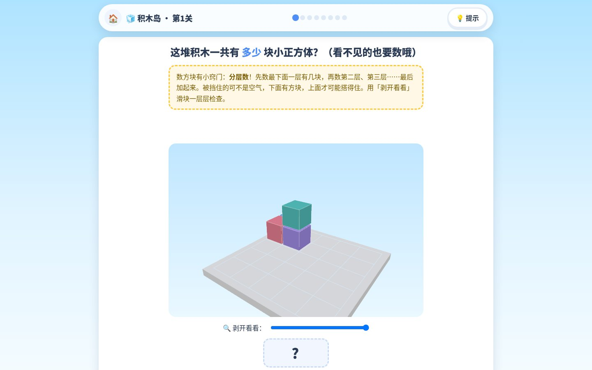 |
| 积木岛 · 认三视图 | 积木岛 · 搭积木 |
| 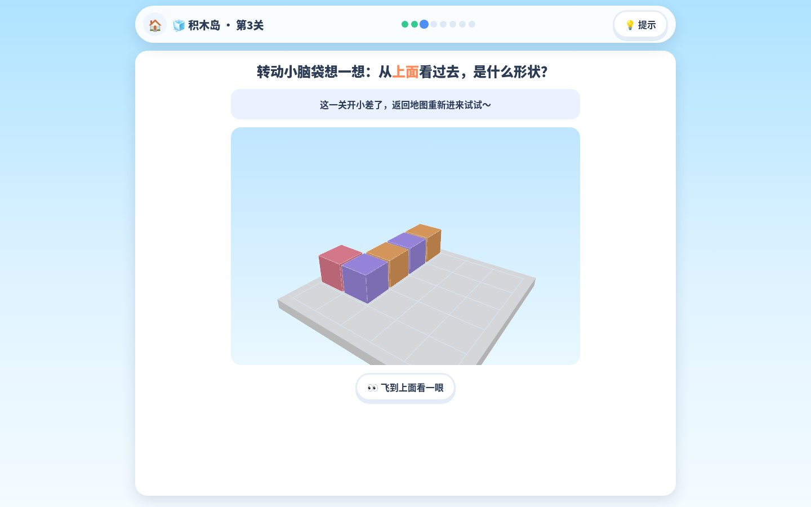 | 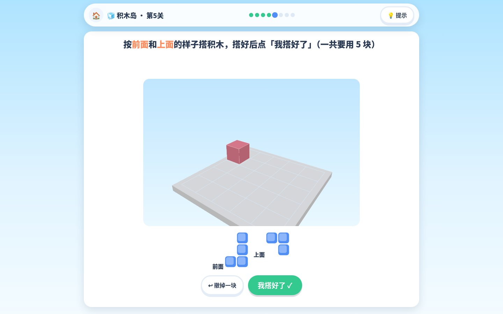 |
| 积木岛 · 数暴露面 | 口算岛 · 闪电战 |
| 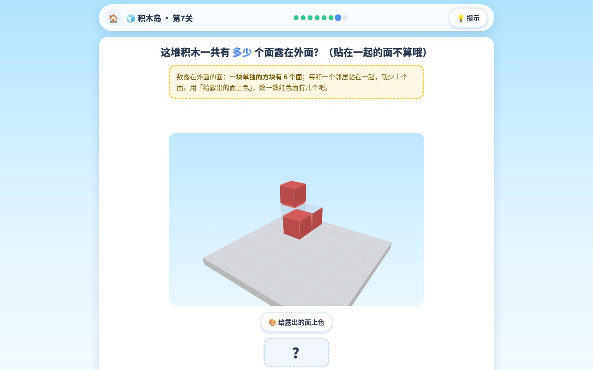 | 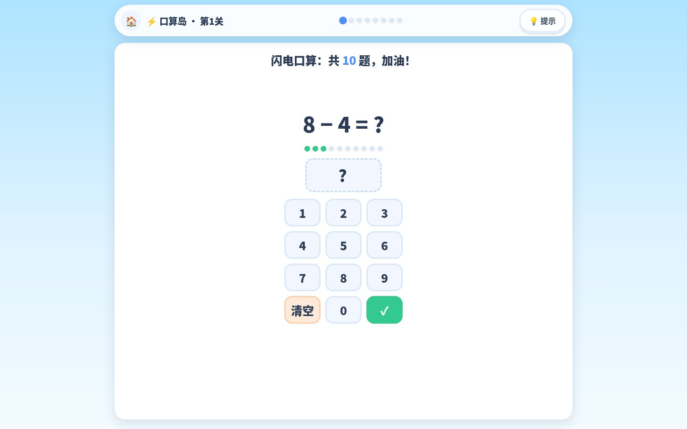 |
| 三星通关 | 时间岛 · 拨指针 |
|  | 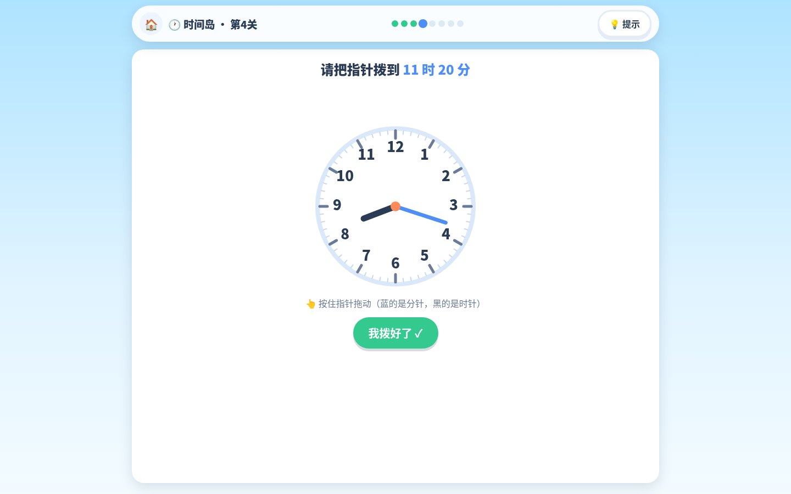 |
| 购物岛 · 凑钱 | 分数岛 · 涂色 |
| 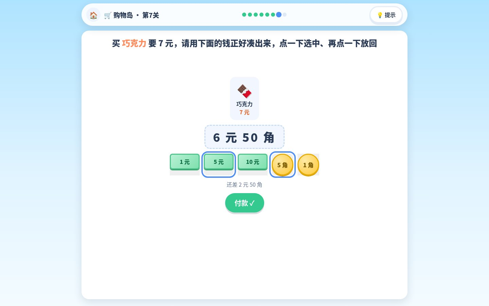 | 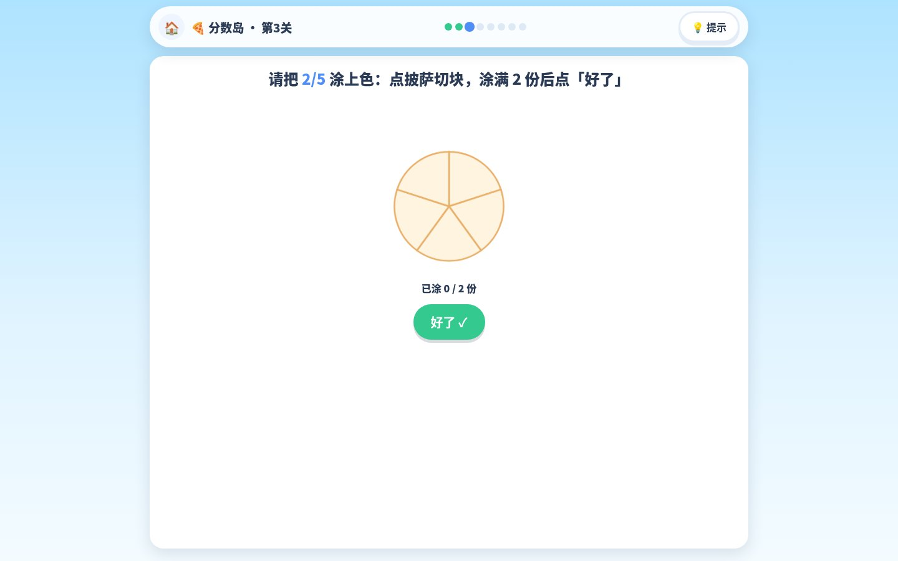 |
| 方向岛 · 走迷宫 | 趣题岛 · 抬腿法 |
| 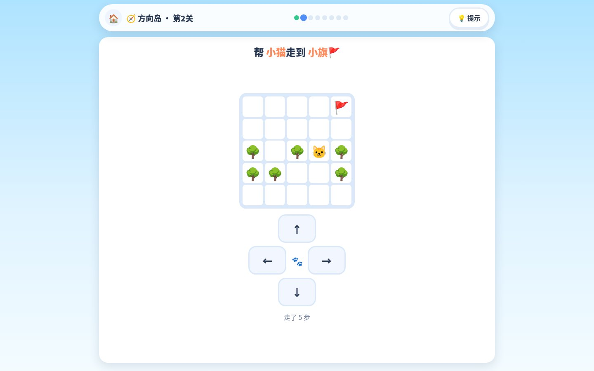 | 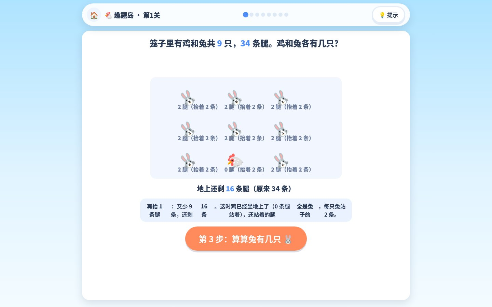 |
| 统计岛 · 搭条形图 | 学习报告 |
| 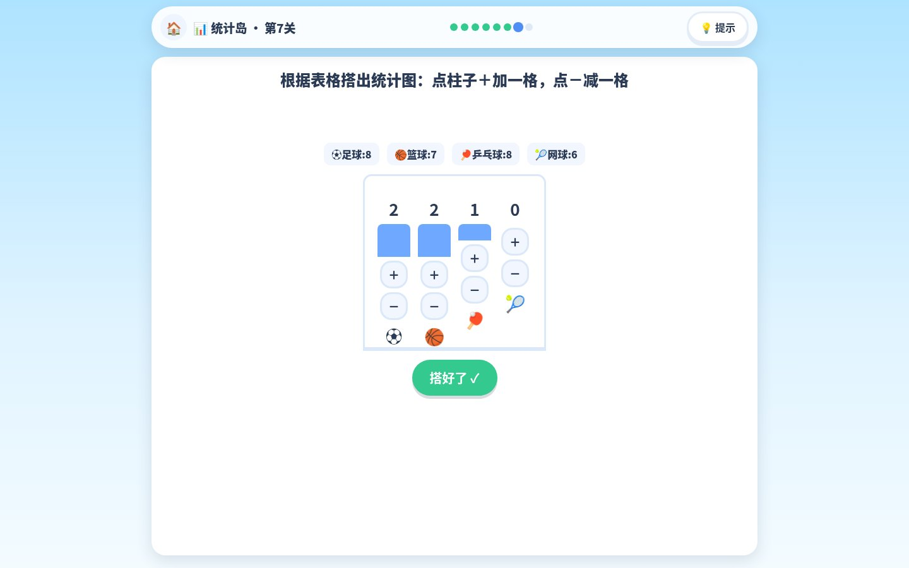 | 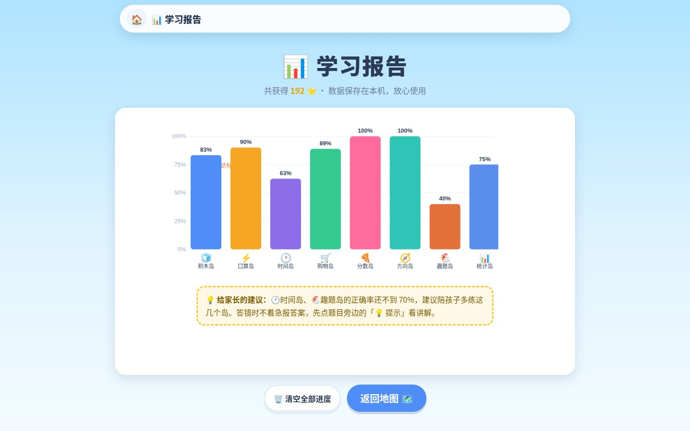 |

更多截图见 [docs/screenshots](./docs/screenshots)。

## 🛠️ 技术栈

纯前端，无后端、无登录、无第三方服务：

- [Vite 5](https://vitejs.dev/) + 原生 ES Modules
- [Three.js r171](https://threejs.org/)（仅积木岛 3D，其余七岛为 Canvas / SVG / DOM）
- Web Audio API 合成音效（无音频文件）
- Canvas 彩带烟花（无图片资源）
- localStorage 进度存储

## 🚀 本地运行

```bash
npm install
npm run dev        # 开发
npm run build      # 构建到 dist/
npm run preview    # 本地预览构建产物
```

## 📁 目录结构

```
src/
├── main.js            # 入口：hash 路由 + 主菜单地图
├── report.js          # 学习报告页
├── styles.css         # 儿童视觉设计系统
├── core/              # 统一游戏化框架
│   ├── ui.js          #   关卡外壳：提示/反馈/数字键盘/三星结算弹窗
│   ├── store.js       #   进度与星级（localStorage）
│   ├── sound.js       #   Web Audio 合成音效
│   └── fx.js          #   彩带烟花
└── islands/           # 八大岛，每岛实现统一接口
    ├── blocks/        #   积木岛：cubes(生成) views(三视图) render3d(场景)
    ├── mental.js      #   口算岛
    ├── clock.js       #   时间岛
    ├── shop.js        #   购物岛
    ├── fraction.js    #   分数岛
    ├── maze.js        #   方向岛
    ├── chicken.js     #   趣题岛
    └── stats.js       #   统计岛
```

每座岛实现同一个接口：`{ id, icon, name, color, grades, blurb, levelCount, hintFor(level), play(ctx, level) }`，框架负责外壳，岛只负责出题与判分，新增一岛只需在 `main.js` 注册。

## 🌐 部署

`main` 分支推送后由 [GitHub Actions](.github/workflows/deploy.yml) 自动构建并发布到 GitHub Pages。

## 💛 关于这个项目

这个项目由 [余阳辉](https://github.com/Wyy520-create) 为孩子制作。选题对齐小学数学新课标的四大领域，每道题都先想"孩子卡在哪里"，再设计提示怎么温柔地拉一把。愿小朋友们玩得开心，算得漂亮。

## 📜 License

[保留所有权利 · 详见 LICENSE](./LICENSE)
